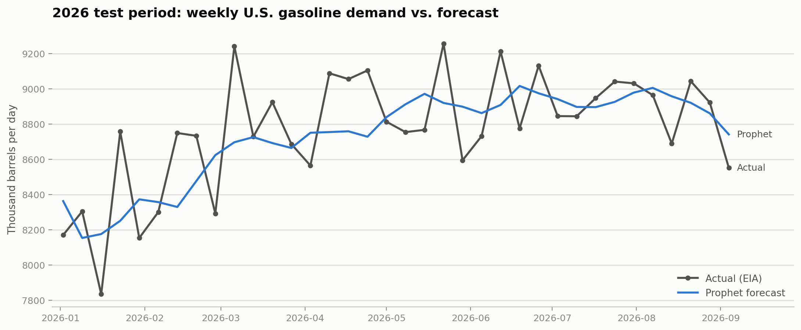
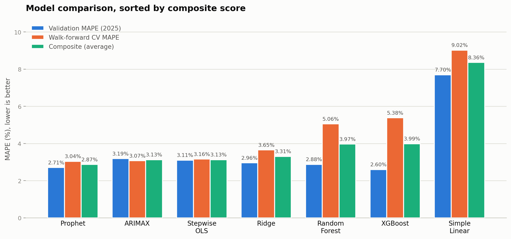

# Forecasting Weekly U.S. Gasoline Demand

A seven-model forecasting comparison for weekly U.S. gasoline demand, built for a Trinity University case competition sponsored by Sunoco LP. The selected model was graded against 36 weeks of 2026 data it had never seen.

**Result:** the selected Prophet model forecast the 2026 test period with a **2.34% mean absolute percentage error (MAPE)**, compared with 7.16% for the required baseline (a simple linear trend) on the same weeks. That cuts typical weekly error by about two thirds, from roughly 615 to 205 thousand barrels per day.



## The business question

Sunoco is a fuel distributor, so its purchasing, inventory, and earnings guidance all depend on how much gasoline the country will use in a given week. The case asked for a model that forecasts weekly implied gasoline demand as reported by the EIA, an explanation of what drives it, and specific guidance for four groups: Supply & Trading, Sales Representatives, Executives, and Data Scientists.

The case supplied only the demand series itself. Every predictor was sourced, cleaned, and merged independently, and each one had a stated hypothesis about why it should matter before it was tested.

## Approach

**Data split (set by the case):** Train 1991 to 2024, Validate 2025, Test 2026. Validation data was never used for fitting or feature selection.

**Predictors.** Roughly 50 to 60 candidates, depending on the model, across weather (heating and cooling degree days, Gulf Coast hurricane and winter storm weeks), prices (crude and retail gasoline, adjusted for inflation), the economy (unemployment, jobless claims, consumer sentiment, industrial production, Fed Funds rate), refining and supply (refinery utilization, gasoline stocks, rig count), policy eras (EV tax credits, fuel-economy standards), holiday travel weeks, and lagged demand moving averages.

**No look-ahead.** Each series is shifted forward by its real publication delay before it is merged. For example, January CPI only becomes visible in mid-February, when it would actually have been released.

**Interaction terms.** Five were tested against a common baseline. Two improved accuracy and were kept in the final model: price x unemployment and price x consumer sentiment. Both reflect the same idea: people cut back on driving faster when prices rise during a weak economy.

**Seven models**, each allowed to choose its own training start year:

| # | Model | Why it was included |
|---|---|---|
| 1 | Simple linear regression | Required baseline (time trend only) |
| 2 | Stepwise OLS | Required; fully interpretable coefficients |
| 3 | Ridge regression | Handles correlated price and economic predictors |
| 4 | Random Forest | Captures nonlinear effects |
| 5 | XGBoost | Captures nonlinear effects |
| 6 | ARIMAX | Models week-to-week autocorrelation directly |
| 7 | Prophet | Refinement step: trend, seasonality, and named predictor effects |

**Selection metric.** Each model was scored two ways: MAPE on the 2025 validation year, and MAPE across four walk-forward folds inside the training data. The final model was chosen on the average of the two (the composite). Validation alone rewards a model for doing well on one particular year; the walk-forward folds check whether it holds up across several different periods.

## Results



| Model | Validation MAPE | Walk-forward CV MAPE | Composite |
|---|---|---|---|
| **Prophet (selected)** | 2.71% | 3.04% | **2.87%** |
| ARIMAX | 3.19% | 3.07% | 3.13% |
| Stepwise OLS | 3.11% | 3.16% | 3.13% |
| Ridge | 2.96% | 3.65% | 3.31% |
| Random Forest | 2.88% | 5.06% | 3.97% |
| XGBoost | 2.60% | 5.38% | 3.99% |
| Simple linear (baseline) | 7.70% | 9.02% | 8.36% |

**2026 test period (36 weeks):**

| Model | Test MAPE | Test RMSE (thousand bbl/day) |
|---|---|---|
| **Prophet (selected)** | **2.34%** | 246 |
| Equal-weight ensemble (Prophet, ARIMAX, Stepwise) | 2.48% | 259 |
| Stepwise OLS | 2.57% | 283 |
| ARIMAX | 2.66% | 284 |
| Simple linear (baseline) | 7.16% | 694 |

For scale, U.S. demand ran about 7,800 to 9,300 thousand barrels per day during the test period, so a 2.34% error is roughly 205 thousand barrels per day in a typical week.

## Key findings

- **XGBoost had the best validation score but would have been the wrong pick.** It was most accurate on 2025 alone (2.60%) but the least stable across earlier periods (5.38%). Selecting on validation accuracy alone would have chosen an overfit model.
- **Three very different models agreed.** Prophet, ARIMAX, and Stepwise OLS landed within 0.26 points of each other on the composite despite working in completely different ways. That convergence suggests the predictors capture real structure, not one model's quirks.
- **Lagged demand and refinery utilization mattered across nearly every model family**, which makes them the most trustworthy drivers.
- **Price sensitivity depends on the economy.** The kept interaction terms show demand reacts more sharply to price when unemployment is high or sentiment is low.
- **The EV and fuel-economy policy flags picked up a gradual, structural decline** in long-run demand growth that is separate from seasonal swings.
- **The ensemble was the safer bet but Prophet won the year that counted.** Averaging the top three scored better on cross-validated risk, but Prophet alone did better on the actual 2026 weeks. Those are two different goals, and the write-up treats that as a finding rather than a failure.

## Limitations

- **Weak at predicting direction.** In the original analysis, Prophet called the correct week-over-week direction only 53% of the time across the full history, barely better than a coin flip. It tracks the level of demand well, not short-term moves, so it suits volume planning, not timing decisions.
- **Well-calibrated uncertainty.** Its 80% prediction interval contained the actual value 82% of the time, so the stated uncertainty range is a reasonable guide to risk.
- **Unprecedented shocks.** A pandemic-scale event or severe supply disruption outside the training history would not be anticipated. In production this would need monitoring against the expected error band and human override during clearly abnormal periods.
- **Test timing.** By the time forecasts were generated, actual demand had been published for 34 of the 36 test weeks, since the competition ran after the period began. No model saw those values during fitting, and the final week needed a one-step recursive forecast because the prior week's actual was not out yet.

## What I'd revisit

The tree models' poor stability comes mostly from the 2012 training start they were evaluated on, chosen for its validation score. Their first walk-forward fold trains on only about eight years of data and misses by roughly 10%. With the full 1991 history, Random Forest and XGBoost both score about 3.2% on the composite, much closer to the linear and time-series models. Prophet still ranks first either way, but the training window for each model family should have been chosen on the composite score, the same rule used to pick the final model.

## Repository structure

```
data/
  raw/          public source files used by the pipeline (see Data sources)
  processed/    modeling panels, generated by build_datasets.py (not committed)
src/
  config.py           paths, the Train/Validate/Test split, and each model's panel
  build_datasets.py   merges raw sources into weekly panels with publication lags
  features.py         holiday weeks, extreme weather events, extra FRED series, interactions
  models.py           the seven models and how each is scored
  metrics.py          MAPE, RMSE, and the walk-forward CV folds
  evaluate_models.py  scores all models and writes the comparison table
  forecast_2026.py    refits the finalists on Train + Validate and forecasts 2026
  make_charts.py      charts in outputs/figures/
outputs/        comparison table, validation and test predictions, charts
experiments/    summary of what was tested and dropped along the way
```

## How to run

Python 3.10 or later.

```bash
pip install -r requirements.txt
python src/build_datasets.py     # build the weekly panels (seconds)
python src/evaluate_models.py    # score all seven models (about 3 minutes, mostly the ARIMAX order search)
python src/forecast_2026.py      # final 2026 forecast
python src/make_charts.py
```

Rebuilding the panels from raw files can shift Prophet's walk-forward CV score by a few hundredths of a point (3.04% here vs. 3.05% in the original write-up). The rebuilt panels differ from the originals by less than one billionth because of floating-point rounding, and Prophet's optimizer is sensitive to that. Every other model reproduces exactly.

## Data sources

All data is public. The target is EIA's weekly U.S. product supplied of finished motor gasoline (series WGFUPUS2).

| File | Source |
|---|---|
| `eia_weekly_gasoline_demand.csv` | EIA weekly gasoline product supplied (target), as available at forecast time |
| `eia_gasoline_product_supplied_latest.xls` | Same EIA series downloaded later, used only to score all 36 test weeks |
| `weekly_predictor_panel.csv` | Weekly panel compiled from public sources: FRED, EIA, BLS, BEA, the New York Fed, TSA, Baker Hughes, and others |
| `eia_refinery_utilization.xls`, `eia_gasoline_stocks.csv`, `eia_crude_field_production.xls` | EIA Weekly Petroleum Status Report and Petroleum Supply Monthly |
| `noaa_heating_degree_days.csv`, `noaa_cooling_degree_days.csv` | NOAA monthly degree days |
| `fred_*.csv`, `fred_cpiaucsl.xlsx` | FRED: unemployment, payrolls, consumer sentiment, CPI, NASDAQ, Fed Funds, 10-year Treasury, housing starts, industrial production |
| Hurricane and winter storm dates (in `features.py`) | NOAA NHC HURDAT2 and NOAA NCEI billion-dollar disaster records |

---

Luke | Business Analytics, Trinity University
